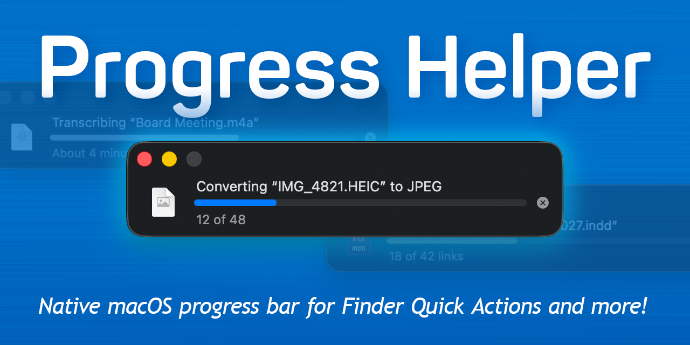

# Progress Helper

Native macOS progress bar for Finder Quick Actions and more.



Ever wished you could have native progress bar support for your Automator Quick Actions in the Finder? Tired of that disappointing spinning gear icon being the only way your user knows a script is running?

Wish no more: Progress Helper is designed to give you native progress bar support for your automations on macOS!

Your script gets the same window Finder shows when it compresses a file: the file's icon, a progress bar with a stop button, and a status line underneath. You drive it from a shell script, AppleScript, Python or a Shortcut. Three commands open it, update it and close it.

- **Looks like it came with your Mac.** It's built from the same window controls Finder uses, and it follows light and dark mode.
- **Stop means stop.** Click the ✕ and your script finds out on its next check, even if it's halfway through a slow file.
- **Run several jobs at once.** Each one gets its own window, and new windows open a step down and to the right so none hides another.
- **One line to install.** Homebrew does the work. You don't need sudo or an Apple developer account, and it runs on any Mac with macOS 12 or later, Apple Silicon or Intel.

## Install

```bash
brew install phennessey/tap/progress-helper
```

To use it from AppleScript as well, install the library once:

```bash
progress-helper setup-applescript
```

Requires macOS 12 or later, on Apple Silicon or Intel.

### From source

```bash
git clone https://github.com/phennessey/progress-helper.git
cd progress-helper
make install
```

This builds with the Xcode Command Line Tools and installs into `~/.local`, with no sudo. Set `PREFIX` to install somewhere else.

## Use it from a shell script

```bash
id=$(progress-helper start --watch-pid $$ --icon "$file" --label "Preparing…" --indeterminate)

progress-helper update "$id" --label "Compressing “$(basename "$file")”" --total 10 --completed 3 --status "3 of 10"

if progress-helper cancelled "$id"; then
    echo "You clicked stop"
fi

progress-helper end "$id"
```

`start` opens a window and prints a session ID. Pass that ID to every other command. `--watch-pid $$` closes the window by itself if your script exits without calling `end`.

Quick Actions run with a minimal `PATH`, so add this line near the top of a "Run Shell Script" action:

```bash
export PATH="/opt/homebrew/bin:/usr/local/bin:$HOME/.local/bin:$PATH"
```

## Use it from AppleScript

```applescript
use script "ProgressHelperLib"
use scripting additions

progress bar start
progress bar update total steps 0 description "Preparing…"
repeat with i from 1 to 10
	progress bar cancel -- raises error -128 if you clicked stop
	progress bar update icon someFile description "Exporting file " & i total steps 10 completed steps i status ("" & i & " of 10")
	-- do the work for item i
end repeat
progress bar end
```

Script Editor shows the full dictionary under File > Open Dictionary > ProgressHelperLib.

| Command | What it does |
|---|---|
| <code>progress&nbsp;bar&nbsp;start</code> | Prepares a window. It appears with the first update. |
| <code>progress&nbsp;bar&nbsp;update</code> | Every parameter is optional: `total steps`, `completed steps`, `description` (the main line), `status` (the grey line), `icon` (a file whose icon to show). `total steps 0` shows the animated waiting bar. |
| <code>progress&nbsp;bar&nbsp;cancel</code> | If you clicked stop, closes the window and raises error -128. Call it once per loop. |
| <code>progress&nbsp;bar&nbsp;end</code> | Closes the window. With a message, `progress bar end "Done"` shows it with a full bar for a moment first. |

Wrap your loop in `try … on error number -128` to stop quietly when you click stop.

## Examples

[`examples/`](examples) has two Quick Actions you can paste into Automator:

- [`compress-quick-action.sh`](examples/compress-quick-action.sh) zips each selected file, in shell.
- [`convert-images.applescript`](examples/convert-images.applescript) makes JPEG copies of selected images, in AppleScript.

## Commands

```
progress-helper start [options]            open a window, print its session ID
progress-helper update SESSION [options]   change what the window shows
progress-helper cancelled SESSION          exit 0 if you clicked stop, 1 if not
progress-helper end SESSION                close the window and clean up
progress-helper setup-applescript          install the AppleScript library
```

| Option | Effect |
|---|---|
| `--label TEXT` | The main line. Long text gets shortened in the middle, like Finder. |
| `--status TEXT` | The grey line under the bar. |
| `--icon FILE` | Show that file's Finder icon. Without an icon, the text and bar use the full width. |
| `--no-icon` | Remove the icon. |
| `--indeterminate` | The animated waiting bar, for steps with no measurable progress. |
| `--total N` | Switch to a real bar with N steps. |
| `--completed N` | Move the bar to step N. |
| `--watch-pid PID` | Close the window if that process exits. `start` only. |

Exit codes: `update` returns 0 when it works, and also after you click stop. It returns 69 if the window crashed or was killed. A wrong session ID returns 66, and bad arguments return 64.

## How it works

`start` makes a private session folder in your temporary directory, creates a named pipe inside it, and launches a second copy of itself to draw the window. `update` writes one line per change into the pipe, and the window applies each line as it arrives. Clicking stop, or the red close button, writes a `cancelled` file into the session folder and closes the window. That file stays until your script calls `end`, so a script busy with a slow step still sees the stop when it next checks.

Each session has its own folder and window, so several scripts can show progress at once. Windows open on your main display and step down and to the right when more than one is open.

## Tests

```bash
make test               # automated checks; windows flash on screen while they run
tests/manual-test.sh    # clicks only a person can do: stop button, close button, layout
```

## Uninstall

```bash
brew uninstall progress-helper
rm -rf ~/Library/"Script Libraries"/ProgressHelperLib.scptd
```

From a source install, run `make uninstall`.

## License

MIT. See [LICENSE](LICENSE).
